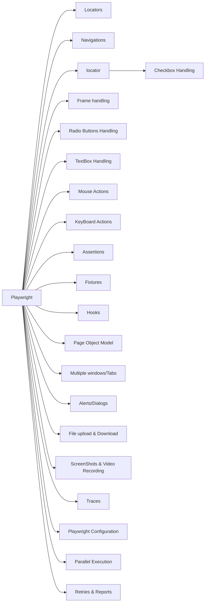

# 📘 Playwright Learning Roadmap

 

---

# 🎯 About This Repository

This repository contains my **Playwright learning journey**, covering concepts from the fundamentals to advanced Playwright and practical test automation.

The goal is not just to learn Playwright syntax, but to understand how Playwright can be used to build:

- 🧪 Test automation frameworks
- 🌐 Web automation
- 🔌 API automation
- 🛠️ Reusable utilities
- 📦 Scalable automation architecture
- 🚀 CI/CD-ready test frameworks

---

  

    
# 🗺️ Playwright Learning Roadmap

---

  
 <b> Playwright Concepts </b>  &emsp; 

<ol type=1>
<li> Playwright Architecture</li>

<li> Locators
  <ol type=I>
<li> Inbuilt Locators</li>
<li> CSS selector</li>
<li> Xpath</li>
    </ol>
</li>
<li> Mouse actions &emsp;
  <ol type=I>
<li> Hover &emsp; </li>
<li> Right Click &emsp;</li>
<li> Double click &emsp;</li>
<li> Drag and drop </li>
<li> horizontal slider</li>
<li> vertical slider</li>
    </ol>
</li>
<li> Keyboard actions
  <ol type=I>
<li> single press</li>
<li>holdiing key</li>
    </ol>
</li>
<li> Radio Button</li>
<li> Checkboxes </li>
<li> buttons </li>
<li> File upload/Download</li>
<ol type=I>
<li> single file upload</li>
<li> multi file upload </li>
    </ol>
<li> Alerts/Dialog</li>
<li> Snapshots / Videos</li>
<li> Assertions </li>
</ol>

---

  
 <b> Playwright Interview Questions </b> 

  <ol type=1> 
 <b>General and Core Concepts </b>
   <li> What is Playwright?</li>
   <li>What are the key features of Playwright?</li>
   <li>What languages does Playwright support?</li>
 <li>How is Playwright different from Selenium?</li>
  <li>What are the components of Playwright?</li>
 <li>What is a BrowserContext in Playwright?</li>
 <li>What is a Locator?</li>
  <li>How is auto-waiting implemented in Playwright?</li>
 <li>What is the role of Expect?</li>
    <li>What is the difference between Page and Context?</li>

<b>Browser and Element Interactions</b>

  <li>How do you handle a browser in Playwright?</li>
  <li>What is the use of Headless mode in Playwright?</li>
  <li>How do you capture screenshot in Playwright?</li>
   <li>How do you record video in Playwright?</li>
   <li>How do you handle multiple tabs in Playwright?</li>
  <li>How do you handle popups in Playwright?</li>
   <li>How do you handle frames in Playwright?</li>
   <li>How do you run tests in parallel?</li>
  <li>How do you configure test retries?</li>
  <li>How do you capture API response in Playwright?</li>
  <li>How do you mock APIs in Playwright?</li>
  <li>How do you handle authentication?</li>
   <li>How do you integrate Playwright with CI/CD?</li>
   <li>How do you debug tests in Playwright?</li>
    <li>How do you generate test report in Playwright?</li>

<b>Automation Strategies and Scenarios</b>

  <li>What is Page Object Model (POM) in Playwright?</li>

  <li>How do you wait in Playwright?</li>
  <li>How do you handle file upload?</li>
  <li>How do you handle scrolling in Playwright?</li>
    <li>How do you handle alerts in Playwright?</li>
    <li>How do you perform drag and drop?</li>
    <li>How do you handle network failures?</li>
    <li>How do you test on mobile devices?</li>
    <li>How do you test login functionality?</li>
  <li>How do you handle cookies in Playwright?</li>
   <li>What is Trace Viewer in Playwright?</li>
    <li>How do you generate trace?</li>
    <li>How do you perform visual testing?</li>
    <li>How do you test file download?</li>
    <li>How do you test WebSockets?</li>

<b>Advanced Performance and Maintenance</b>

    <li>How do you handle slow network?</li>
    <li>How do you test accessibility?</li>

  <li>How do you handle sessions and storage?</li>
    <li>How do you test in different browsers?</li>
 <li>How do you handle dynamic content?</li>
  <li>How do you structure a Playwright project?</li>
   <li>How do you test performance?</li>
  <li>How do you handle flaky tests?</li>
  <li>How do you test on different environments?</li>
  <li>How do you keep tests stable?</li>

✅𝐏𝐥𝐚𝐲𝐰𝐫𝐢𝐠𝐡𝐭 𝐰𝐢𝐭𝐡 𝐀𝐈 𝐓𝐞𝐬𝐭𝐢𝐧𝐠 𝐓𝐫𝐚𝐢𝐧𝐢𝐧𝐠 𝐬𝐭𝐚𝐫𝐭𝐬 𝐨𝐧 𝟓𝐭𝐡 𝐎𝐜𝐭𝐨𝐛𝐞𝐫 𝟐𝟎𝟐𝟔! 𝐑𝐞𝐠𝐢𝐬𝐭𝐞𝐫 𝐧𝐨𝐰 𝐟𝐨𝐫 𝐟𝐫𝐞𝐞 𝐝𝐞𝐦𝐨 𝐜𝐥𝐚𝐬𝐬𝐞𝐬:
https://wa.link/gr8c64

  </ol>

&emsp;
&emsp;
